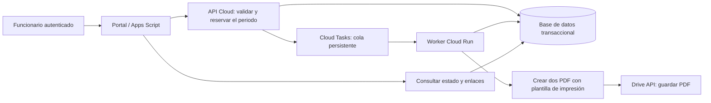

# Diagnóstico y arquitectura para los picos de informes

## Hallazgo principal

En el código original Cloud Run recibía IDs de dos Google Docs. Apps Script copiaba la plantilla dos veces, rellenaba ambos documentos, organizaba carpetas y, en el flujo individual, recibía base64 y creaba los PDF en Drive. Por eso el servicio Cloud no quitaba las operaciones principales de Docs y Drive de Apps Script.

El lote esperaba `urlRemu/urlTransp`, mientras la generación individual esperaba `pdfRemuBase64/pdfTranspBase64`. No había un contrato único. Firebase tenía un cliente REST, pero no participaba del registro ni de las reservas mensuales.

Las comprobaciones de duplicado y algunas búsquedas de filas ocurrían antes del candado, seguidas de escrituras posteriores. Las cargas retenían un candado global durante las operaciones de Drive y llamaban nuevamente al registro. Los reintentos repetían copias y archivos completos. Algunas cargas devolvían éxito aunque fallara la actualización del historial.

## Límites que siguen existiendo

[Google documenta](https://developers.google.com/apps-script/guides/services/quotas) 6 minutos por ejecución de Apps Script, 30 ejecuciones simultáneas por usuario, 1.000 por script y cuotas diarias por servicio. Publica 1.500 documentos creados por día para cuentas Workspace y 250 para cuentas personales. El consumo exacto de las operaciones de este proyecto debe comprobarse en la cuenta real; no se puede deducir un aforo de funcionarios solo con esa tabla.

El despliegue actual usa `USER_DEPLOYING`: se ejecuta bajo la autoridad del publicador, tal como explica [Google sobre las aplicaciones web](https://developers.google.com/apps-script/guides/web). El número de funcionarios registrados no equivale al número de identidades que ejecutan el backend.

[Drive también aplica cuotas](https://developers.google.com/workspace/drive/api/guides/limits), incluso al usar sus API desde Cloud. Más instancias de Cloud Run no convierten el almacenamiento en ilimitado. Las solicitudes de una cuenta de servicio cuentan como una misma cuenta a estos efectos. Deben medirse las cuotas efectivas del proyecto y de la identidad de Drive; no se debe confiar en números antiguos copiados de tutoriales.

## Lo que resuelve el ajuste local

La reserva y el límite global reducen las carreras y las ráfagas. El control persistente permite reconocer lo ya creado, mantener el bloqueo mensual y registrar el avance y los errores. Los IDs binarios de Drive evitan nuevas copias en los reintentos de escritura; Google documenta los [IDs generados previamente](https://developers.google.com/workspace/drive/api/guides/manage-uploads).

Este ajuste conserva un proceso sincrónico: el navegador espera y reintenta cuando no obtiene un turno. **No es una cola persistente**, y no completa nuevos trabajos pendientes después de cerrar la pestaña. Los documentos ya generados siguen siendo recuperables al identificarse de nuevo.

## Arquitectura propuesta

La API recibe la solicitud y responde rápidamente con un identificador. Una transacción reserva una clave única por persona, año y mes. Una solicitud repetida devuelve el trabajo existente. Se puede usar Firestore o implementar transacciones correctamente en Realtime Database; un GET seguido de PUT no constituye una reserva atómica.

La cola regula tanto la cantidad de trabajos simultáneos como la tasa de despachos. [Cloud Tasks ofrece esos controles y reintentos](https://docs.cloud.google.com/tasks/docs/configuring-queues). El worker debe tolerar entregas repetidas: la cola no sustituye la idempotencia del proceso ni el control mensual.

El worker reproduce la plantilla institucional en HTML/CSS de impresión o en una herramienta PDF del servidor. Esta adaptación requiere revisar la plantilla real y validar la salida. Genera una versión privada completa y una versión pública a partir de datos depurados; después guarda ambas directamente mediante Drive API. Deja de copiar y editar Google Docs en cada generación y evita transportar PDF en base64 de regreso a Apps Script.

El bloqueo mensual se mantiene desde la reserva hasta el cierre. Un error permite reanudar el mismo trabajo; una rectificación posterior al cierre debe dejar una nueva versión autorizada y un evento de auditoría, conservando el documento anterior.

La base operacional guarda estados, referencias y eventos. Sheets puede recibir una proyección para consulta administrativa en lotes y quedar fuera del camino crítico. El token o clave Cloud nunca debe enviarse al navegador. La autenticación del funcionario y la autorización de jefaturas y soporte se comprueban en la API.

## Acceso a Drive desde Cloud

Hay que verificar si las carpetas pertenecen a una unidad compartida o a Mi unidad. Google señala que las cuentas de servicio no tienen cuota de almacenamiento ni pueden ser propietarias de archivos; se debe usar una unidad compartida o una identidad de usuario mediante el mecanismo de autorización adecuado. Esta limitación explica posibles problemas que el código original intentaba evitar devolviendo los bytes a Apps Script. [Documentación de errores y almacenamiento de Drive](https://developers.google.com/workspace/drive/api/guides/handle-errors).

La delegación de dominio, si corresponde, requiere autorización institucional; no se debe configurar sin ese contexto. Cloud Tasks invoca el worker privado con una identidad de servicio y permisos mínimos. Usar una clave de aplicación no configura por sí mismo la autenticación IAM de Cloud Run.

## Medición antes de fijar capacidad

Para 1.831 funcionarios y picos de 2.300, medir primero una muestra: duración de generación, tamaño de PDF, solicitudes a Drive, latencias y errores. Después repetir con 1, 3, 6 y 9 clientes reales de ensayo. Si el tiempo medio es `T` y hay `C` workers efectivos, la capacidad aproximada de procesamiento es `C/T` informes por segundo, antes de considerar cuotas y errores. Es una estimación, no un compromiso de servicio.

En el ensayo debe cortarse la conexión después de guardar cada versión, perderse una respuesta HTTP, recargarse la página y repetirse la solicitud desde otro cliente. Debe comprobarse que el mismo periodo produce una sola operación, que las dos versiones permanecen trazables y que el PDF público no contiene el texto reservado al copiarlo o extraerlo.

## Información pendiente para implementar la migración

- Código y configuración del servicio Cloud Run actual: renderer, autenticación, identidad que accede a Docs/Drive y respuesta real del endpoint.
- Método institucional para acreditar identidad y rol del funcionario.
- Plantilla real y criterio municipal de censura, especialmente salud, terceros y documentos escaneados.
- Tipo de almacenamiento Drive y permisos de las carpetas.

Con esa información se puede adaptar el servicio existente y reemplazar el proceso sincrónico. Esta revisión no ha desplegado una cola ni afirma haber verificado el aforo de producción.

Se intentó consultar el proyecto del servicio mediante la CLI instalada, pero la identidad configurada no tiene permiso sobre ese proyecto. No se modificaron cuentas, permisos ni servicios Cloud.
