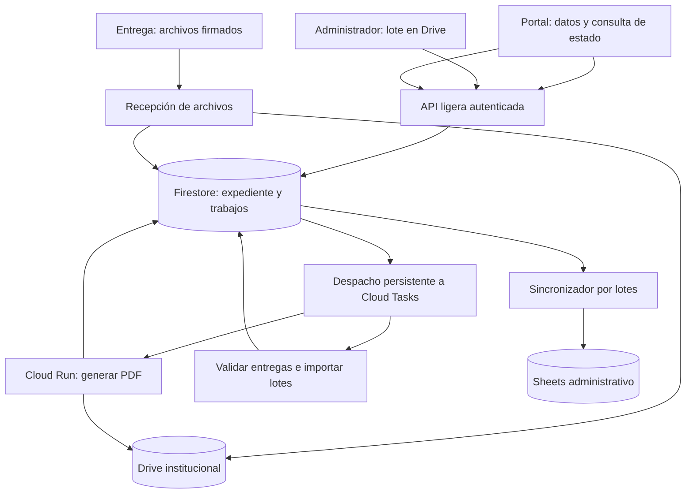

# Plan de operación y costes para 1.853 honorarios

Fecha: 20 de octubre de 2026. Estado: propuesta técnica revisada; sin cambios en producción. Sustituye como plan principal a `PLAN_CAPACIDAD_100_USUARIOS_2026-10-20.md`.

## 1. Decisión recomendada

Implementar recepción persistente y procesamiento asíncrono para generación, entrega y carga administrativa. Conservar la plantilla HTML, Drive como archivo institucional y Sheets como registro administrativo. Usar Firestore para el estado operacional y Cloud Tasks para regular el trabajo de Cloud Run.

Comenzar con un máximo efectivo de cinco generaciones en paralelo, escalado a cero cuando no haya trabajo y facturación por solicitudes. Preparar un perfil de cierre de hasta diez generaciones, activable después de medir Drive y el flujo completo. La carga manual de archivos terminados no debe ejecutar Chromium ni generar de nuevo los PDF.

El objetivo es que un pico produzca espera visible y recuperable, sin perder solicitudes ni bloquear la entrega de documentos ya preparados. No se promete respuesta inmediata ante cualquier volumen. Los 1.853 son personas/periodos previstos, no una obligación de mantener 1.853 procesos simultáneos.

## 2. Alcance, evidencia y pendientes

Se supone un informe por persona y mes: hasta 1.853 expedientes mensuales y 22.236 anuales. Cada generación produce dos PDF, por lo que el máximo base es 3.706 PDF generados por mes, más archivos firmados, versiones externas y rectificaciones. La cantidad real de adjuntos por modalidad debe medirse.

El código local limita globalmente a tres generaciones y cuatro cargas. Los reintentos de ocupación dependen del navegador y se agotan. Las reservas, los puntos de control y el registro pasan por Sheets; Apps Script todavía transporta los PDF y guarda archivos en Drive. `Masivo.js` genera por persona: no importa automáticamente los documentos que un administrador deja en una carpeta.

El servicio HTML tiene una generación por proceso. Su caché de deduplicación es local y temporal. La prueba documentada del 14 de octubre obtuvo los dos PDF desde Cloud en aproximadamente 2,2–10,3 s, según tanda; no incluyó almacenamiento final ni registro. Los 30 s informados por el usuario son la referencia del flujo actual completo, no una medición del tiempo facturable exclusivo de Cloud.

Se intentó leer la configuración activa con `gcloud run services describe`; la sesión requiere reautenticación. Por ello no están verificados hoy los mínimos/máximos efectivos, facturación real, cuotas restantes, identidad de Drive ni gasto mensual. La auditoría antigua que menciona una instancia mínima es un antecedente, no prueba del estado actual. La planificación puede completarse con estos pendientes; deberán resolverse antes del despliegue.

## 3. Demanda que debe soportar

Dimensionar inicialmente como si las 1.853 personas generaran por el portal. Las cargas manuales son una reducción de trabajo, no una condición necesaria para que el diseño funcione.

| Escenario de llegada de generaciones | Demanda media | Consecuencia con cinco workers de 30 s |
| --- | ---: | --- |
| 1.853 en cinco jornadas de ocho horas | 0,77/min | Amplio margen medio; probar picos |
| 1.853 en una jornada de ocho horas | 3,86/min | Compatible en promedio |
| 371 en los últimos 30 minutos | 12,37/min | La cola crece; usar perfil de cierre o aceptar más espera |
| 1.853 en una hora | 30,88/min | Supera cinco y diez workers; admitir y procesar después |
| 100 pulsando Generar juntos | Pico de 100 | Conservar los cien trabajos; mostrar espera |

La capacidad teórica es `C × 60 / T` informes por minuto, con C workers efectivos y T segundos por trabajo. Para operación sostenida, usar inicialmente solo el 70 % de esa cifra al planificar: cinco workers a 30 s dan un presupuesto de 7/min; diez, 14/min. Es un margen de diseño, no una medición.

| Capacidad efectiva, T=30 s | Pico de 20 | Pico de 100 | 1.853 recibidos juntos |
| --- | ---: | ---: | ---: |
| 3 | 3 min 30 s | 17 min | 5 h 9 min |
| 5 | 2 min | 10 min | 3 h 5 min 30 s |
| 10 | 1 min | 5 min | 1 h 33 min |

Son tiempos ideales de vaciado, sin arranque, errores ni contención. Si T=60 s, se duplican. Si se requiere completar veinte solicitudes nuevas por minuto de forma sostenida, diez workers a 30 s quedan al 100 % y sin margen: se necesitarían aproximadamente quince a ese tiempo, o reducir T. No contratar esa capacidad por anticipado para un pico ocasional.

## 4. Tres flujos que comparten un expediente

### A. Generar desde el portal

Guardar datos validados y reservar persona/año/mes en Firestore. Responder con identificador y fecha de recepción. Crear una tarea; Cloud genera ambas versiones y las guarda en Drive con IDs persistidos antes de subir. Al terminar, el portal ofrece los enlaces. Una nueva pulsación consulta el mismo trabajo; no genera una segunda pareja.

`GENERADO` significa PDF disponible. No significa que el informe firmado fue entregado.

### B. Entregar archivos firmados o externos

La transferencia del archivo se atiende en un servicio ligero separado del renderizador. Enviar binarios por streaming a Drive, con tamaño acotado, validación de tipo y comprobación de contenido, sin base64 dentro de Apps Script ni dentro de Cloud Tasks.

Reservar el expediente y los IDs, asociar hash/tamaño/tipo y mantener una sesión de carga recuperable. Tras guardar y verificar el archivo en Drive, persistir el comprobante de recepción y encolar la validación/cierre. Si la respuesta se pierde, consultar esa sesión y comprobar el archivo antes de volver a transferirlo.

La cola puede continuar el procesamiento de un archivo ya recibido; no puede recuperar bytes que nunca llegaron del navegador. Mostrar «puede cerrar» solo después de confirmar la recepción durable. Un cierre durante la transferencia deja una carga incompleta, no una entrega finalizada. La implementación de sesiones y recuperación se prueba con archivos del tamaño máximo actual de 5 MB por adjunto.

Separar las fechas de recepción y de procesamiento. Conservar la primera aunque la validación o Sheets se retrasen; la aceptación administrativa mantiene sus propias reglas. «Recibido» y «aceptado» deben ser estados distintos.

### C. Cargar manualmente un lote

El administrador deposita PDF individuales en Drive y presenta un manifiesto de persona, periodo, ID de original e ID de transparencia. Un botón «Validar lote» realiza una revisión previa y «Recibir lote» registra cada entrada. El portal consulta el mismo expediente para detectar conflictos.

Reutilizar archivos ya ubicados en el archivo institucional controlado. Si siguen siendo modificables por el remitente, copiar a un destino controlado al aceptar y persistir los IDs. No regenerar PDF válidos. Un lote con solo el original queda incompleto hasta aportar la versión requerida; no marcarlo como finalizado.

Si el lote solicita generar documentos a partir de datos, entra a la cola de generación masiva con cupo menor. Si trae un PDF conjunto, solicitar un manifiesto de páginas para separar cada persona; no añadir OCR o IA como paso ordinario. Las versiones externas de transparencia requieren el procedimiento de revisión correspondiente.

## 5. Arquitectura y controles contra saturación

Los módulos ligeros pueden compartir imagen de código, pero recepción y render deben tener despliegues y presupuestos de concurrencia separados. Todos pueden escalar a cero. Los límites siguientes son puntos de partida para ensayo:

| Trabajo | Perfil normal | Perfil de cierre | Protección |
| --- | --- | --- | --- |
| Generación interactiva | Hasta 4 tareas simultáneas | Hasta 8 | Cola propia |
| Generación administrativa | Hasta 1 | Hasta 2 | No consume todos los cupos interactivos |
| Worker PDF | Máximo 5 instancias, concurrencia 1 | Máximo 10, concurrencia 1 | Un par de PDF secuenciales por instancia |
| API de datos/estado | 1 vCPU/512 MiB, concurrencia inicial 20, máximo 3 instancias | Igual al principio | Validar con carga y limitar por sesión |
| Transferencia de archivos | 1 vCPU/512 MiB, concurrencia inicial 4, máximo 2 instancias | Ajustar solo tras medir | Streaming; control de tamaño y sesiones |
| Validación/importación | 2 tareas concurrentes en total | 2 inicialmente | Entradas pequeñas, reanudables |
| Sincronización Sheets | Un escritor con lease | Igual | Lotes y versiones, sin append ciego |

Para PDF empezar probando 1 vCPU/1 GiB y una petición por instancia. Comparar con 2 vCPU/2 GiB por coste por informe exitoso, memoria máxima y tiempo. No elegir más CPU únicamente porque acelera una prueba aislada.

Las colas interactivas y masivas comparten el techo total del renderer. Si la cola masiva está vacía, se puede transferir su cupo al portal manteniendo ese techo; no suponer que las colas tienen prioridad automática. Inicialmente limitar despachos de generación a 1/s por cola; ajustar según tasa real y Drive.

La consulta de estado usa API autenticada directa, solo para el trabajo de ese usuario: 10–15 s al inicio, después 30–60 s, con variación aleatoria y detención al completar o al ocultar la página. El panel administrativo consulta un resumen cada 60 s. No escanear todos los expedientes ni consultar Sheets por cada usuario.

Como referencia, cien usuarios consultando cada 15 s son unas 400 consultas/minuto; 1.853 serían unas 7.412/minuto. La segunda carga requiere probar o alargar intervalos y utilizar respuestas cacheadas. Tener 1.853 personas registradas no justifica mantenerlas a todas consultando permanentemente.

El login, la consulta de nómina y la jefatura también deben salir del camino crítico de Sheets mediante un catálogo privado versionado en Cloud. Sheets puede seguir siendo la fuente administrativa de nómina. Refrescar al publicar cambios; impedir aceptación con una versión retirada. La UI de Apps Script puede mantenerse durante la transición, pero las acciones operativas no deben seguir consumiendo ejecuciones largas de la cuenta publicadora. Si la propia carga inicial de Apps Script falla en las pruebas de cien usuarios, trasladar su entrega estática como fase adicional.

## 6. Registro único, recuperación y seguridad operacional

- Mantener un expediente único por persona/año/mes, con trabajos separados de generación, carga y revisión. Registrar el canal: portal, externo o administración. La identidad se acredita mediante sesión autorizada; el RUT por sí solo no es autenticación.
- Reservar con transacción. Guardar estado y evento pendiente de despacho en la misma transacción; crear la tarea con nombre determinista. Un reconciliador repara el intervalo entre guardar la solicitud y crear Cloud Tasks.
- Usar lease con vencimiento y versión; únicamente el dueño vigente confirma el resultado. Persistir los IDs de cada PDF y cada adjunto. La caché local actual no basta entre instancias.
- Confirmar éxito de la tarea después de guardar el resultado durable. Clasificar errores: datos inválidos van a revisión; 429/errores transitorios reintentan con espera; permisos revocados pausan el flujo afectado y alertan.
- Empezar ensayando 10 intentos y una ventana de 24 h para fallos transitorios. No repetir continuamente durante una caída. Un reconciliador detecta trabajos estancados o intentos agotados y deja una acción visible para soporte. No presumir que la cola es un archivo permanente de expedientes.
- Alinear timeout del worker, deadline de la tarea y lease. Ensayar 180 s por intento; renovar el lease o mantener margen suficiente para evitar dos workers activos sobre el mismo trabajo.
- Los lotes no sobrescriben una operación activa del portal. Una entrega manual definitiva cierra la generación futura de ese periodo; una rectificación exige versión y auditoría.
- Guardar datos de actividades y datos personales solo donde sean necesarios y con permisos restringidos; las métricas usan identificadores opacos. No registrar cuerpos, PDF/base64 ni tokens en logs.

La escritura directa desde Cloud necesita unidad compartida institucional o una identidad de usuario autorizada para el destino. Una carpeta compartida de Mi unidad no equivale a unidad compartida. Confirmar esta dependencia antes de construir el uploader: el servicio local actual usa Drive readonly.

## 7. Sheets: registro administrativo sin bloquear el portal

Conservar `REGISTRO_HISTORICO` y compatibilidad de sus columnas. La fuente de estado del expediente migrado será Firestore; Sheets recibirá una proyección versionada. Todas las comprobaciones de cierre, incluida la carga manual, consultan esa fuente.

Un solo sincronizador con lease transaccional agrupa inicialmente hasta 50 filas por ejecución, con límite por bytes y tiempo. Se activa por cambios mediante una tarea agrupada para la siguiente ventana de 30–60 s. Cada cambio persiste un evento pendiente. La tarea toma una versión/corte, escribe Sheets y confirma solo esa versión; los cambios posteriores permanecen pendientes. Un reconciliador periódico vuelve a despachar eventos pendientes si se perdió el disparo. No depender de un temporizador en memoria de Cloud Run.

Un job de mantenimiento cada 5 minutos puede recuperar trabajos y sincronizaciones; solo lee consultas pequeñas indexadas. No recorrer Drive o todo el historial cada vez. Una hoja temporalmente caída deja `PENDIENTE_SINCRONIZACION` y los usuarios mantienen acceso al resultado persistido.

Verificar clave de expediente y versión antes de sobrescribir una fila, especialmente si se ordenó la hoja. Las modificaciones administrativas que cambian estados se hacen por la aplicación, no editando una proyección sin reconciliación.

Crear `CONTROL_ENTREGAS` con estado de generación, recepción del firmado, recepción de transparencia, revisión, fecha de recepción, canal y errores. Crear `RESUMEN_CAPACIDAD` con esperados, entregados, faltantes, en proceso, pendientes de revisión y pendientes de sincronizar. El total base es 1.853, ajustable por la nómina elegible de cada periodo; no contar dos PDF como dos funcionarios.

Medir separadamente solicitudes API, unidades de cuota cuando correspondan, archivos/bytes almacenados y expedientes. Los contadores propios no representan toda la cuota restante de la cuenta. Sheets API documenta 300 solicitudes/min/proyecto y 60/min/usuario/proyecto para lecturas y escrituras por separado; no equivale a 60 filas ni se aplica directamente a cada operación de SpreadsheetApp.

Drive actualizó su esquema de cuotas en 2026 y mantiene diferencias según proyecto. Consultar los valores efectivos y el consumo por método; no copiar un límite universal de solicitudes de una guía antigua. Más workers no corrigen una cuota de Drive agotada.

## 8. Costes: modelo y medidas de ahorro

### Cálculo de renderizado

Referencia en USD para us-central1 y facturación por solicitudes, consultada en la documentación oficial el 20 de octubre. Precio activo usado: 0,000024 USD/vCPU-s y 0,0000025 USD/GiB-s. Una instancia de 1 vCPU/1 GiB durante T segundos cuesta `T × 0,0000265 USD`, antes de franquicias.

| Escenario, 1.853 generaciones mensuales | vCPU-s y GiB-s de trabajo | CPU + memoria antes de franquicia |
| --- | ---: | ---: |
| 10 s de worker por pareja | 18.530 de cada uno | USD 0,49 |
| 30 s de worker por pareja | 55.590 de cada uno | USD 1,47 |
| 60 s de worker por pareja | 111.180 de cada uno | USD 2,95 |
| 30 s, pero 2 vCPU/2 GiB | 111.180 de cada uno | USD 2,95 |

Estos importes son únicamente CPU y memoria del trabajo supuesto. No incluyen arranque/apagado facturable, reintentos, recepción de archivos, API, sincronización, base de datos, imágenes, compilaciones, logs, red, almacenamiento institucional, impuestos ni desarrollo. El caso de 30 s es una hipótesis conservadora de modelado, no duración exclusiva de Cloud observada.

Cloud Run publica franquicias mensuales para solicitudes de 180.000 vCPU-s, 360.000 GiB-s y dos millones de solicitudes, compartidas por cuenta de facturación. El render de estos ejemplos podría quedar cubierto si existe saldo; el total del sistema y otros proyectos consumen también ese saldo. No se promete factura cero.

### Efecto de cargas manuales terminadas

| Informes aportados ya terminados | Generaciones restantes | CPU + memoria a 30 s, 1 vCPU/1 GiB |
| --- | ---: | ---: |
| 0 | 1.853 | USD 1,47 |
| 500 | 1.353 | USD 1,08 |
| 1.000 | 853 | USD 0,68 |

El ahorro principal de estas cargas también es operativo: menos trabajo del usuario y menos render/archivos duplicados. Si el lote contiene datos para generar, no se resta de las generaciones.

### Otros consumos

- Cloud Tasks: primer millón de operaciones mensuales gratuito por cuenta; se cuentan creación, intentos y otras operaciones, no solo tareas. Enviar IDs pequeños y evitar listar repetidamente toda la cola.
- Firestore: franquicia de 50.000 lecturas y 20.000 escrituras diarias para la base elegible. Un presupuesto ilustrativo de 20 escrituras y 50 lecturas por expediente supone 37.060 escrituras y 92.650 lecturas para 1.853. En un solo día excedería esas franquicias antes de otros accesos; repartido puede quedar cubierto. Instrumentar operaciones reales, transacciones, índices y sondeos. No confundir franquicia con límite máximo de capacidad.
- Scheduler: un job de mantenimiento, aprovechando la franquicia si está disponible. El precio publicado fuera de ella es USD 0,10 por job/31 días; las ejecuciones del destino tienen consumo propio.
- Drive: usar el almacenamiento institucional disponible y medir crecimiento. A modo de ejemplo, cuatro archivos de 1 MB por persona son 7,4 GB/mes, unos 89 GB/año antes de versiones. Una carga de dos adjuntos de 5 MB por persona suma hasta 18,53 GB en el mes solo en adjuntos. Son hipótesis de tamaño; medir los PDF reales y la capacidad contratada.
- No guardar PDF en Firestore ni duplicarlos en Cloud Storage por defecto. Incorporar almacenamiento temporal solo si las pruebas de carga reanudable o una necesidad concreta lo justifican, con su propia limpieza y presupuesto.

Presupuesto provisional de control: reservar USD 10/mes de infraestructura Cloud para el piloto y configurar alertas de gasto/predicción en USD 5, 10 y 20. Es una provisión a validar con facturación, no una cotización ni techo garantizado, y excluye Workspace, desarrollo y soporte. Los presupuestos de Google no cortan automáticamente el gasto.

### Medidas que sí reducen el coste

1. Mínimo de instancias cero en todos los servicios y revisiones, verificando que no haya revisiones antiguas con mínimos activos. Facturación por solicitudes; nada de pings para mantener Chromium encendido.
2. Activar hasta diez workers solo cuando la cola y la latencia lo justifiquen. Para el mismo trabajo total, más instancias durante menos tiempo no multiplican automáticamente el coste; medir arranques y recursos por informe.
3. Renderizar únicamente si no existe una versión válida; conservar la deduplicación después de reinicios. No regenerar al consultar o al entregar el firmado.
4. Registrar referencias a archivos manuales controlados sin copiar de nuevo; reutilizar carpetas y sus IDs. Evitar recorridos completos de Drive.
5. Mantener datos de configuración/plantilla y Chromium reutilizables por proceso. No bajar memoria hasta provocar fallos y reintentos.
6. Agrupar Sheets; consultar estado con intervalos crecientes; dejar de consultar al terminar. No actualizar contadores globales por cada sondeo.
7. Logs breves por transición y error, sin documentos completos. Retención de imágenes de contenedor limitada a las versiones necesarias para despliegue y reversión. Sin VMs, Kubernetes, balanceador o conector VPC permanentes salvo necesidad demostrada.
8. Mantener inicialmente la región actual para presupuestar, sujeto a la política institucional de ubicación de datos. Verificar región disponible de Firestore y alinear servicios cuando corresponda; no migrar datos existentes solo para perseguir una franquicia.

## 9. Operación durante el cierre mensual

Proponer entregas por unidades a lo largo de tres a cinco días, manteniendo la capacidad de aceptar fuera de esa distribución. Los lotes se preparan antes del último día; las generaciones masivas se ejecutan con su cupo reservado o fuera de los picos.

El panel muestra edad del trabajo más antiguo, backlog por flujo, duración p95, tasa de llegada/salida, entregas recibidas y sincronización. Una estimación de espera se presenta como rango, nunca como posición exacta: las colas y reintentos no aseguran FIFO estricto.

| Señal inicial | Respuesta operativa |
| --- | --- |
| Edad de generación >3 min durante 5 min o llegada >7/min sostenida | Si no hay saturación de Drive, pasar de cinco a diez workers ensayados |
| 429 de Drive o errores transitorios >1 % con muestra suficiente | Reducir despachos; priorizar recepción; aplicar espera y alertar |
| Sheets atrasado >5 min | Recuperar sincronizador; mantener recepción y generación |
| Sin trabajos completados durante 5 min con cola pendiente | Alertar, revisar permisos/worker y detener reintentos inútiles |
| Memoria >80 % de forma sostenida o reinicios | Revisar fugas/tamaño y subir memoria tras medir |
| Gasto/predicción sobre provisión | Revisar mínimos, duplicados, polling, logs y llamadas; no cortar entregas silenciosamente |

Para subida, informar avance y permitir reanudar. Para generación aceptada, se puede cerrar y volver. Para lotes, entregar recibo con cantidades aceptadas, incompletas, conflictivas y rechazadas; no exigir volver a cargar todo el lote por un error individual.

## 10. Implementación por etapas y aceptación

| Etapa | Trabajo concreto | Criterio para avanzar |
| --- | --- | --- |
| 0. Línea base | Reautenticar lectura Cloud; verificar cuotas/costes/permisos; medir render, Drive, Sheets, cargas y tamaños | Evidencia por fase y destino Drive viable |
| 1. Recepción durable | Sesión autorizada, catálogo versionado, expediente único, outbox, tareas y conciliador | Cierre de pestaña tras recepción no pierde trabajo; doble envío devuelve el mismo ID |
| 2. Generación | Reutilizar HTML; worker idempotente; guardar directo en Drive; estados consultables | Ambas versiones correctas, sin duplicados tras reinicios o pérdida de respuesta |
| 3. Entrega/manual | Sesiones de carga, comprobantes, validación, importador y conflictos por periodo | Portal y administrador no pueden cerrar dos expedientes distintos del mismo mes |
| 4. Sheets y operación | Proyección por lotes, tablero, alertas y recuperación | Caída de Sheets no bloquea recepción; al volver converge sin duplicados |
| 5. Carga y piloto | Ensayos mixtos, piloto por unidad y apertura gradual | Metas y costes observados, reversión preparada |

Las etapas 1–4 son necesarias antes de declarar resuelto el flujo completo. Una cola solo para el renderer deja pendiente la recepción de firmados y la carga administrativa.

Pruebas con datos ficticios:

- 100 sesiones: mezcla de 20 generaciones, 30 entregas y consultas, además de un lote manual de 200. Repetir y medir esperas por flujo.
- 100 solicitudes de generación juntas; 1.853 trabajos a lo largo de una jornada; un pico sintético de 1.853 solicitudes de metadatos admitidas por ráfagas controladas para validar persistencia y drenaje. No afirmar que esto prueba 1.853 transferencias grandes simultáneas.
- Probar cien solicitudes de carga concurrentes, con archivos representativos y de 5 MB: controlar admisión, reintentos, bytes y memoria, aunque solo una parte transfiera al mismo tiempo. El tiempo total depende de ancho de banda y Drive.
- Cortes antes/después de cada archivo, respuesta perdida, worker reiniciado, dos instancias con la misma tarea, vencimiento de lease, cuota temporal, Sheets caído y lote repetido.
- Revisar PDF corto y largo, ambos tipos, y extracción de texto de transparencia; verificar que una entrega externa no se publique automáticamente por estar cargada.

Metas iniciales a validar: recepción de metadatos p95 <3 s en la prueba de cien sesiones; veinte generaciones en <3 min con cinco workers efectivos si se conserva T≈30 s; pico de cien en <15 min; sincronización ordinaria <2 min; cero expedientes/archivos duplicados en pruebas de recuperación; todo trabajo aceptado termina o queda con error accionable. Las subidas requieren un objetivo separado tras medir tamaño y velocidad, no el SLA de tres segundos.

El despliegue se activa por cohorte/periodo, persistiendo qué flujo es dueño del expediente. No ejecutar simultáneamente la reserva antigua de Sheets y la nueva como autoridades independientes. Importar estados cerrados existentes y comprobarlos antes de admitir trabajos. Revertir cierra nuevas admisiones al nuevo flujo, pero conserva y drena sus pendientes; no volver a enviarlos al generador antiguo.

## 11. Fuentes y documentos relacionados

Precios consultados el 20 de octubre de 2026. Confirmar los SKU, moneda y uso compartido de la cuenta al desplegar.

- [Cloud Run: precios, facturación y franquicia](https://cloud.google.com/run/pricing).
- [Cloud Tasks: precios](https://cloud.google.com/tasks/pricing) y [límites/reintentos de colas](https://docs.cloud.google.com/tasks/docs/configuring-queues).
- [Firestore: facturación y franquicias](https://firebase.google.com/docs/firestore/pricing).
- [Cloud Scheduler: precios](https://cloud.google.com/scheduler/pricing).
- [Sheets API: límites](https://developers.google.com/workspace/sheets/api/limits).
- [Drive API: cuotas actualizadas y límites](https://developers.google.com/workspace/drive/api/guides/limits).
- [Unidades compartidas y cuentas de servicio](https://developers.google.com/workspace/drive/api/guides/about-shareddrives).
- Código revisado: `Main.js`, `Concurrencia.js`, `Logica.js`, `Masivo.js`, `JS_SOLICITUDES.html`, `cloud-run/optimizado/index.js`, `cloud-run/optimizado/app.js`.
- Antecedentes: `cloud-run/PRUEBA-CONCURRENCIA-2026-10-14.md`, `docs/RECEPCION_MASIVA_DRIVE.md`. El importador de este plan usa el expediente operacional común y reemplaza la autoridad de reservas del diseño antiguo para el flujo migrado.
